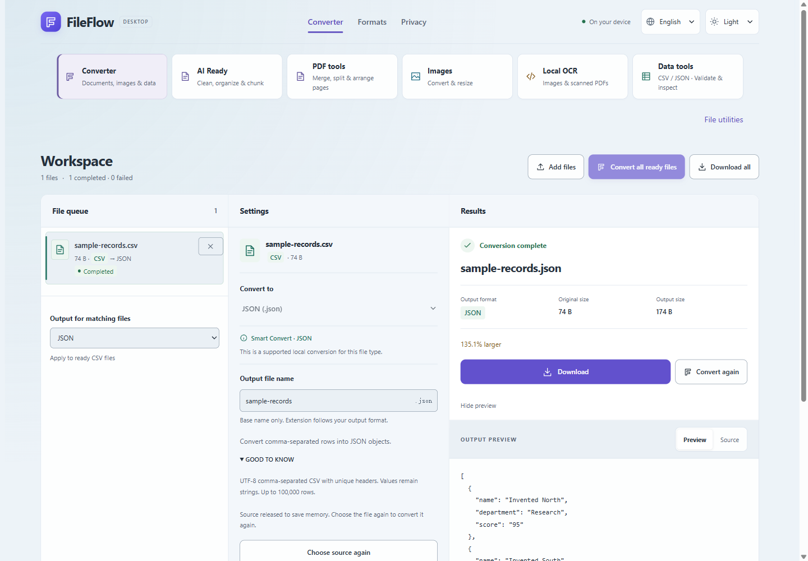
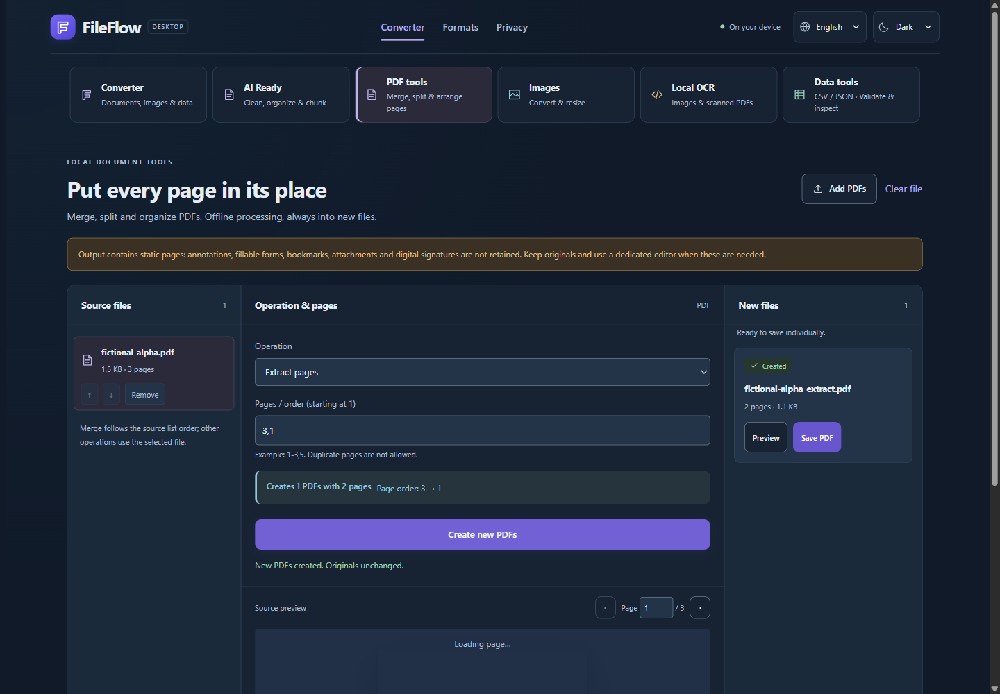
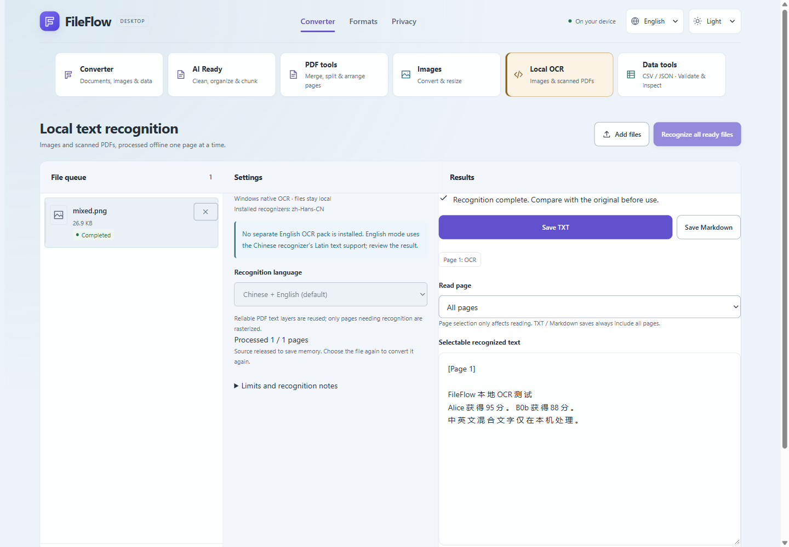

# FileFlow

**在你的设备上转换、识别和整理文件。** Windows 桌面版与浏览器版，支持简体中文 / English。

[English](README.md) · [Windows 安装](docs/github/windows.md) · [隐私与安全](docs/github/security.md)

当前 **0.2.0-rc.1** 已完成单台 Windows 11 设备上的本人本地验收，仍是发布候选版本，不是正式稳定版、生产推荐或独立安全审计结果。**安装包暂未公开**：检查发现开发机编译路径，权限测试也有未覆盖项。[发行状态](docs/github/release-status.md)。

截图来自真实 RC 界面，全部使用程序生成的虚构数据。

## 功能

- **格式转换**：PDF文字、DOCX、UTF-8文本、Markdown/HTML、PNG/JPEG/WebP、CSV/TSV/JSON/YAML和XLSX的支持路线；有界批量队列、预览、取消和安全保存。不代表任意格式互转。
- **AI Ready**：本地确定性建议、保守清理、Outline、分块与导出；干净文档可以无需处理。所有Token都是**预估Token**，不代表具体模型计费，不调用AI API。
- **本地OCR（Windows）**：实际使用 **Windows.Media.Ocr**，支持中英文/混排、扫描与Hybrid PDF、PNG/JPEG/WebP，逐页识别、取消、Retry、Partial和TXT/Markdown导出。可靠文字层优先，无模型打包或静默下载；英文模型缺失时可能使用明确提示的Latin fallback。结果需要校对。Web不提供OCR。
- **PDF六项工具**：合并、拆分、提取、删除、旋转、重排；执行前查看页码/顺序，输出新文件。静态页面处理**不保留批注、表单、书签、附件和数字签名**。
- **图片/数据工具**：尺寸/质量、XLSX→CSV/JSON、数据转换/校验、JSON格式化、Hash与检查。

## 安装与限制

计划的安装包为 Windows11 x64、未签名、per-user NSIS，要求 WebView2 Evergreen Runtime154+，不会联网安装运行时。当前没有公开下载；后续获批后先核对SHA-256、关闭旧版，遵循[安装指南](docs/github/windows.md)。未知发布者/SmartScreen提示可能出现，不关闭系统防护。

| 路线 | Web | Desktop |
|---|---:|---:|
| 普通PDF文字 | 40MiB | 100MiB |
| 普通图片 | 20MiB | 100MiB |
| OCR PDF/图片 | 未提供 | 100MiB |
| PDF工具 | 每份40MiB，合计60MiB | 相同 |
| 文本/DOCX/普通数据 | 10MiB | 10MiB |
| XLSX / 结构化JSON-YAML | 4 / 2MiB | 相同 |

OCR最多100物理页/50OCR页，源图24MP，raster6MP/最长边4096。PDF工具500合计页、50输出、64MiB结果。AI Ready PDF仍40MiB。256MiB为应用计入的临时预算，不是总进程内存上限；200MiB未启用。[完整限制](docs/github/limits.md)。

## 隐私、验证与授权

应用没有文件上传、云转换、AI API、账户、API Key、遥测或付费OCR；文件访问经过用户选择、短期FileGrant、Rust路径验证和安全保存。

Windows选择器可能保留历史；WebView2可生成包含内存的受保护本地dump。官方崩溃上传关闭，但不能证明/控制全部Windows诊断；清理只减少残留。符号链接断言仍未覆盖；最新junction补测也在创建夹具时失败，不伪称全绿。[安全范围](docs/github/security.md)。

既有记录：550/550单元、90/90原浏览器（同次47/47Phase3）、真实桌面OCR/PDF和用户确认的原生/安装/物理断网验收，不等于公开安全认证。[验证结论](docs/github/validation.md)。

架构：React、TypeScript、Vite、Tauri2、Rust、WebView2，共享核心/平台适配层。Node24.15+，锁文件安装；Web运行npm ci、npm run dev/build；桌面另需Rust MSVC1.99+、C++Build Tools/SDK与WebView2，运行npm run desktop:dev/build。PowerShell可用npm.cmd解决npm.ps1签名拦截，不修改策略。[开发指南](docs/github/development.md)。

GitHub从脱敏RC快照开始，本地旧Commit/Tag和原始记录不上传、不删除。[版本沿革](docs/github/history.md)。

**自有代码尚未选择一般开源许可。** 公开可见不等于一般复制/修改/再分发授权；GitHub平台规则与第三方许可分别适用。[代码使用](CODE_USAGE.md) · [第三方分发](docs/github/third-party.md)。

反馈用[Issues](https://github.com/FREExuanwei/FileFlow/issues)，只附虚构最小样本，不上传私人文件、路径、截图或dump。
